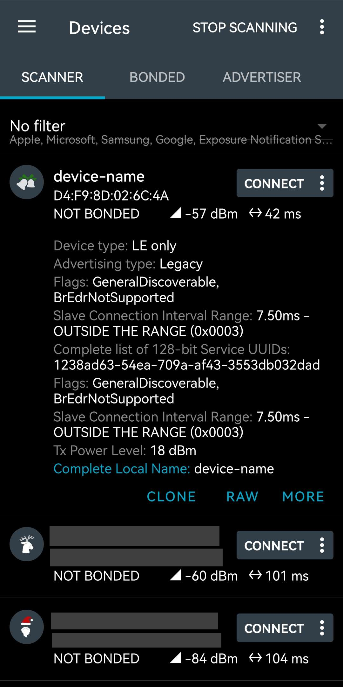
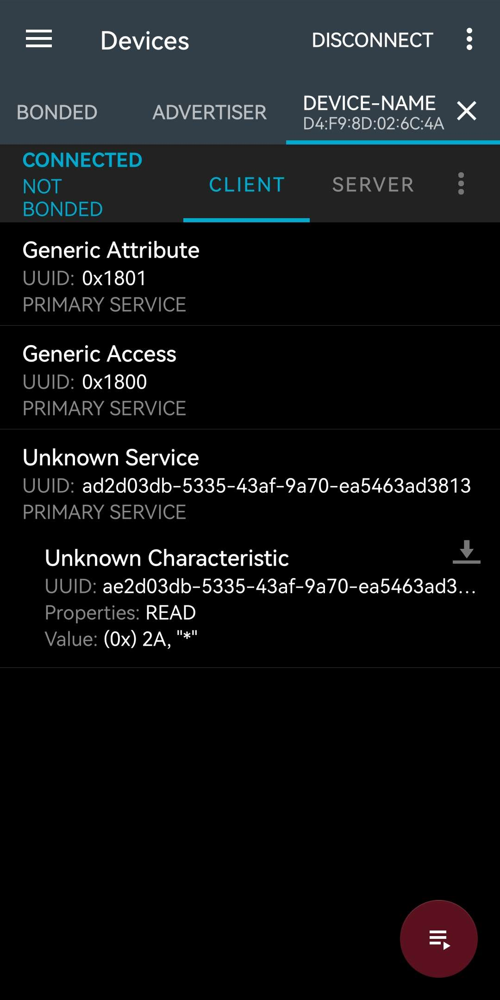

# Documentation of the BLE interface for LispBM

## Introduction

The BLE interface controls the device from LispBM scripts as a BLE server and
client simultaneously. Outgoing connections support script-controlled pairing and
passkey entry.
Server operations include:

1. Defining services with UUIDs and a list of characteristics with their own UUIDs.
2. Defining the access permissions of said charactersistics, including read, write,
   write no response, notify, and indicate.
3. Defining a list of charactersistic descriptors to assign to a characteristic.
4. Reading and writing the values of the characteristics and their descriptors.
5. Customizing the advertisement and scan response packets sent.
6. Scanning, connecting as a GATT client, discovering attributes, reading,
   writing and subscribing while the normal VESC BLE server stays connected.

The BLE host uses NimBLE. One incoming
server connection and multiple outgoing client connections are supported. NimBLE owns
the standard GAP and GATT services. Client behavior is implemented in `custom_ble`;
`comm_ble` provides the optional VESC packet transport and the shared host lifecycle.
Before starting the host, `custom_ble` reserves CCCD resources for the configured
script attribute capacity across the compiled connection limit and NimBLE's server cache.
This allows adding notify/indicate services after startup while retaining space
for outgoing client connections.

## Configuring BLE Scripting

In VESC Tool, open **VESC Express** > **Bluetooth**. The two modes are
independent; write the configuration and reboot after changing them.

| `ble-mode` | VESC Tool service |
| --- | --- |
| 0 | Disabled |
| 1 | Enabled |
| 2 | Enabled and Encrypted (PIN) |

| `ble-mode-lbm` | LispBM roles | Script server | Script client |
| --- | --- | --- | --- |
| 0 | Disabled | No | No |
| 1 | Server | Yes | No |
| 2 | Client | No | Yes |
| 3 | Client & Server | Yes | Yes |

Bluetooth is stopped only when both modes are disabled. The name and PIN
remain shared settings. Script service and attribute capacities apply when the
LispBM server is enabled. Only extensions for the selected LispBM roles are
enabled. Use `(conf-get 'ble-mode-lbm)` to check those roles.

The VESC service can run alongside either scripting role. One incoming connection
is supported, shared by VESC and script services, with the same encryption state.
Encrypted VESC mode requires authenticated pairing to access the VESC service.
Encryption without authentication does not grant access. Outgoing pairing is
controlled independently through `ble-client-security` and
`ble-client-passkey`.

With VESC disabled and LispBM set to Client, no advertising or server services
are registered. This combination also skips VESC packet buffers, transmit queue,
transport mutex, custom service arrays, attribute mutex and additional CCCD
reservation. Use USB or CAN to configure the device. The client event queue is
allocated lazily when scanning or connecting. Shared NimBLE host/controller pools
and compiled connection slots remain allocated according to the build configuration.

For server scripting, configure the amount of services, characteristics and
descriptors you plan to define. Internal arrays that contain these are allocated
at startup, so you need to define the sizes of these. This is done through the
**BLE Service Capacity** and **BLE Characteristic and Descriptor Capacity**
settings. The characteristic and descriptor capacity setting counts the sum of
the number characteristics and descriptors.

**Note**: These settings only take effect after a reboot, which can be achieved
by selecting **Terminal** > **Reboot**.

## The Library

### `ble-start-app`

```clj
(ble-start-app)
```

This enables script services on the already running VESC BLE server. The VESC
packet service and its connection remain available.
This should be called once at the start of the program. It has no effect on
subsequent calls (currently, the only way to stop the BLE server is to power
cycle the VESC). It returns `true` the first time it is called and `nil` on
subsequent calls.

This function may throw an `eval_error` if some previous internal mechanism
has failed.

### `ble-set-name`

```clj
(ble-set-name name)
```

Configure the name that the BLE server advertises as the device's name. So
essentially, the devices name in the BLE system.

The name must not be longer than 30 characters. Providing a longer name will
throw an `eval_error`. The default scan response includes up to 29 name bytes;
a 30-byte name is advertised as a shortened name. The complete name remains
available through the GAP Device Name characteristic.

This should be called *before* the BLE server has started (so before
[`ble-start-app`](#ble-start-app) is called). Then `true` is returned. Calling it afterwards has no effect
and returns `nil`.

### `ble-conf-adv-set-channels`

```clj
(ble-conf-adv-set-channels channels)
```

Configure channels to use for advertising. Channels is a list and must contain a combination of 37, 38 and 39. By default all channels are used. Example:

```clj
; Use all channels for advertising
(ble-conf-adv-set-channels '(37 38 39))
```

### `ble-conf-adv-set-interval`

```clj
(ble-conf-adv-set-interval min max)
```

Configure minimum and maximum advertising interval in units of 0.625 ms. Both intervals (min and max) must be within 0x0020 and 0x4000 (20 ms to 10.24 s). Example:

```clj
(ble-conf-adv-set-interval 0x400 0x800)
```

### `ble-conf-adv`

```clj
(ble-conf-adv false)
(ble-conf-adv use-custom adv-data scan-rsp-data)
```

Configure if custom advertising data should be used, and which packets to
send in that case. `use-custom` is a bool which if true specifies that the
custom advertising and scan response packets should be used. If false,
`adv-data` and `scan-rsp-data` are ignored and do not need to be provided, since
a standard packet is used instead (see the example below to see its contents).

`adv-data` and `scan-rsp-data` are used to specify the packets that are used
with advertising and scan responses. They can either be an array which specifies
the raw bytes to be sent as the packet, or a list with cons cells of the form
`(name-symbol-or-number . array)` (Must be an integer from 1 to 255 inclusive if
a number, see [BLE Advertising](#ble-advertising) for valid symbols and other
details). If the resulting packet is longer than 31
bytes an `eval_error` is thrown. You can pass `nil` to either to specify that
it should not be updated and that the previously configured packet should remain
in effect (both custom packets are initialized to be an empty array before
configuring them with `ble-conf-adv`).

This extension returns `nil` in the case of an unknown error occuring
related to the internal BLE APIs. Otherwise `true` is returned.

This extension can be called before or after the BLE server has been started
with [`ble-start-app`](#ble-start-app), so at any time. Calling it after the BLE
server has been started will cause advertising to restart automatically.

This function takes raw or almost completely raw packets, so you should read the section
about [BLE Advertising](#ble-advertising) if you're unsure about BLE internals.

Example that disables custom advertising and scan response packets:
```clj
(ble-conf-adv false)
```

Example that sets an advertising packet configuring the name `"test"` and some
flags. It also configures an empty scan-response by leaving it unchanged.
```clj
(def adv-data `(
    (flags . [0x06])
    (name-complete . ,(buf-resize "my-device" -1)) ; We shrink it to not include the terminating null byte.
))

(ble-conf-adv true adv-data nil)
> t
```

The following example configures packets that are identical to the ones sent by
default (assuming that you'd configured the device name to be "test").
```clj
(def adv-data `(
    (flags . [0x06])
    (name-complete . [0x74 0x65 0x73 0x74]) ; "test" in ascii
    (conn-interval-range . [0x06 0x00 0x03 0x00])
))
(def scan-rsp-data `(
    (flags . [0x06])
    (tx-power-level . [0x12])
    (conn-interval-range . [0x06 0x00 0x03 0x00])
))

(ble-conf-adv true adv-data scan-rsp-data)
```

Example that configures the same default packets using raw byte-arrays instead:
```clj
(def adv-data [
    0x02 0x01 0x06                ; flags
    0x05 0x09 0x74 0x65 0x73 0x74 ; name-complete
    0x05 0x12 0x06 0x00 0x30 0x00 ; conn-interval-range
])
(def scan-rsp-data [
    0x02 0x01 0x06                ; flags
    0x02 0x0A 0x12                ; tx-power-level
    0x05 0x12 0x06 0x00 0x30 0x00 ; conn-interval-range
])

(ble-conf-adv true adv-data scan-rsp-data)
```

### `ble-add-service`

```clj
(ble-add-service service-uuid characteristics)
```

Add a service with the given list of characteristics.

This function needs to be called after [`ble-start-app`](#ble-start-app) has been
called. Calling it before will throw an `eval_error`.

The service-uuid is given as a byte array representing either a 16-, 32-, or
128-bit UUID, so it should be 2, 4, or 16 bytes long. The order of the bytes is
big endian, which means that you write the bytes in the same order as you would
write it in text (so the UUID 4be24176-71ae-11ee-b962-0242ac120002 would be represented
by the lbm value `[0x4b 0xe2 0x41 0x76 0x71 ... 0x12 0x00 0x02]`).

Service UUIDs must be unique among scripted services. UUIDs `0x1800` (GAP)
and `0x1801` (GATT) are reserved. Attempts to use these or duplicate service
UUIDs return an `eval_error`.

This function returns a list of service, characteristic, and descriptor handles
in the order they were defined, with the service handle being first (See the
example below). This function can also return a `type_error` or `eval_error`.

#### `characteristics` Format

The characteristics list is defined by a list of associative lists, where each
assoc list defines a single characteristic. Assoc lists are lists with cons
cells as items. Where the car fields hold the lists keys, while the cdr fields
hold the keys respective values.

The valid entries are as follows:
- `'uuid`: The characteristic's UUID, same format as the service UUID.
- `'prop`: A list of any combination of the symbols `'prop-read`, `'prop-write`,
  `'prop-write-nr`, `'prop-indicate`, `'prop-notify`, which correspond to the
  access flags for this characteristic.
- `'max-len`: The maximum value length (in bytes) that can be written to this
  characteristic.
- `'default-value` \[optional\]: A byte array which will be set as the
  characteristics initial value. The length of this should not be longer than
  `max-len`.
- `'descr` \[optional\]: A list of descriptors to assign to this characteristic
  (see below).

The descriptor list follows a very similar format to the characteristic list,
except only the `'uuid`, `'max-len`, and `'default-value` entries are valid.

**Note**: NimBLE automatically adds a client characteristic configuration
(CCCD) descriptor for `prop-notify` or `prop-indicate`. Existing scripts may keep
an explicit descriptor with UUID `[0x29 0x02]`, max length 2, and initial value
`[0 0]`: its returned handle maps to the CCCD created by NimBLE. If omitted,
this automatic descriptor is not included in the script's returned handle list.
Clients control subscriptions; `ble-attr-set-value` cannot write a CCCD.
Notifications and indications are sent only to subscribed clients.

#### Example

```clj
(ble-add-service [0xbe 0xb5 0x48 0x3e] '(
    (
        (uuid . [0xbe 0xb5 0x48 0x4e])
        (prop . (prop-read prop-write prop-notify))
        (max-len . 100)
        (descr . (
            (
                (uuid . [0x29 0x02]) ; the ccc-uuid
                (max-len . 2)
                (default-value . [0 0])
            )
        ))
    )
))
> (40u 42u 43u)
```

This creates a service with the 32-bit UUID [0xbe 0xb5 0x48 0x3e] with a single
characteristic that has the 32-bit UUID [0xbe 0xb5 0x48 0x4e] (these UUIDs are
complete nonsense). Client devices are allowed to read, write the value of this
characteristic, which can at most be 100 bytes long.

Clients are also allowed to subscribe to notifications of changes to the value,
which is why we need to add the CCC descriptor to the characteristic. The value
of and behavior of this descriptor is handled automatically by the BLE server.
Note that we also could have defined any other characteristics if we wanted to.

This function then returns a list of handles. The service handle 40 comes first,
followed by the characteristic and descriptor handles 42 and 43 respectively.
These can be used with the other library functions.

### `ble-remove-service`

```clj
(ble-remove-service service-handle)
```

Remove the given service, along with the associated characteristics and
descriptors, freeing the resources in the process. `service-handle` should be a
number which was the first number in the list of handles returned by
[`ble-add-service`](#ble-add-service).

Due to technical limitations (that should probably be possible to remove),
services need to be removed in the reverse order they were created in. Say you
created two services, **Service A** and then **Service B**, in that order. To
remove them, you would have to first remove **Service B**, followed by
**Service A**. This is because the services are stored on a stack internally, so
you need to pop them in the order you usually would with a stack.

Example which remove the service with the handle 40, which was the service which was
created last:

```clj
(ble-remove-service 40)
> t
```

### `ble-attr-get-value`

```clj
(ble-attr-get-value attr-handle)
```

Get the current value of a characteristic or descriptor (referred to generally as
an attribute) as a byte array. `attr-handle` should be a number
returned by [`ble-add-service`](#ble-add-service).

Providing an invalid handle will throw an `eval_error`.

Example where the value of the attribute with the handle 42 is set to the
byte-array `"hello"`, and then queried:

```clj
(ble-attr-set-value 40 "hello")
(ble-attr-get-value 40)
> "hello"
```

### `ble-attr-set-value`

```clj
(ble-attr-set-value attr-handle value)
```

Set the value of the attribute to the provided value. `attr-handle` should be a
number that was returned by [`ble-add-service`](#ble-add-service) and `value` a byte
array. **Note** that the raw byte without modification will be stored, and since strings are null
terminated in LBM, setting the value to a string literal will include the
terminating null byte. You will have to create a copy of the byte array without
the final byte to avoid this behavior. Here is an example function that does
this using
[`bufcpy`](https://github.com/vedderb/bldc/blob/master/lispBM/README.md#bufcpy):
```clj
(defun trim-null-byte (str) {
    (var len (str-len str))
    (var cpy (bufcreate len))
    (bufcpy cpy 0 str 0 len)
    cpy
})
```

Providing an invalid handle will throw an `eval_error`.

Setting the value of a characteristic automatically sends notifications or
indications to subscribing clients if those flags were set when the
characteristic was defined.

Example that sets the value of the attribute with the handle 40 to "hello":
```clj
(ble-attr-set-value 40 "hello")
; it now contains the bytes [0x68 0x65 0x6c 0x6c 0x6f 0x0]
```

### `ble-get-services`

```clj
(ble-get-services)
```

Get the list of the handles of the currently active services, excluding any
services that have already been removed. The handles are returned in the order
they were created in. If you want to remove them, you would need to reverse the
list first!

Example that gets the currently active service handles:

```clj
(ble-get-services)
> (40u)
```

In this case, only a single service had been created.

### `ble-get-attrs`

```clj
(ble-get-attrs service-handle)
```

Get the list of characteristic and descriptor handles assigned to the given service
when it was created. `service-handle` should be a number that was returned by
[`ble-add-service`](#ble-add-service). Providing an invalid handle throws an
`eval_error`.

This function essentially returns the same list returned when `ble-add-service` was
first called, just without the first item (since that item would correspond to the service's
handle).

Example where the attribute handles of the service 40 are queried:

```clj
(ble-get-attrs 40)
> (42u 43u)
```

In this case, the service was defined with a single characteristic with a
descriptor that had the handles 42 and 43 respectively.

## Events
Too know when a client has written to a characteristic or descriptor, an LBM
event is fired. The semantics work the same as with
[normal events](https://github.com/vedderb/bldc/blob/master/lispBM/README.md#events).
The event message consists of a list of the form
`('event-ble-rx handle data)`, where the `handle` is the handle number of the
attribute's that was written to, and the `data` is the byte-array that was
written by the client.

Here is an example of a setup that catches and logs these events, printing the
values as strings:
```clj
(defun proc-ble-data (handle data) {
    (print (str-merge
        "Value "
        (to-str data)
        " written to attribute handle "
        (str-from-n handle)
    ))
})

(defun event-handler ()
    (loopwhile t
        (recv
            ((event-ble-rx (? handle) (? data)) (proc-ble-data handle data))
            (_ nil) ; Ignore other events
        )
    )
)

(event-register-handler (spawn event-handler))
(event-enable 'event-ble-rx)
```

## BLE Advertising

> Back to [`ble-conf-adv`](#ble-conf-adv)

These APIs require you to configure advertising and scan response packets by
giving the raw bytes. This is to allow you as much as control as possible,
something which is very important because the packets can only be up to 31 bytes
long each, so optimizing their size is crucial. If this sounds intimidating
fret not, as it's not that complicated as this guide should hopefully make
clear!

To make it slightly nicer to specify these packets than to just having to give a
single long byte-array, there is a alternative syntax where you give a list of
the fields present in the packet. You can also just give raw arrays if that is
more convenient. Each field is a cons cell of the form
`(type-symbol-or-number . array)`. The car field corresponds to the type of the
field, and should normally be one of the symbols defined in the list below. But
since there are a large number of types, and memory is limited, only a handful
of types are given dedicated symbols. You can therefore also specify the type
with the integer as defined in the specification. The cdr field on the other
hand corresponds to the raw data associated with the field type and should
therefore be a byte-array.

Here is a list of all defined type symbols and their meanings. These are
taken from the [**Bluetooth Assigned Numbers, Section 2.3**](#references)
document.

| Type | Number | Description | Reference |
| -- | -- | -- | -- |
|`'flags`| `0x01` | General config flags. It is a bit field containing low level information about capabilities, see example for a reasonable default, or the reference for the individual bit fields. | [**Bluetooth Core Specification Supplement, Part A, Section 1.3**](#references) |
|`'incomplete-uuid-16`| `0x02` | Incomplete list of 16-bit service uuids, meaning that there are more 16-bit services available. | [**Bluetooth Core Specification Supplement, Part A, Section 1.1**](#references) |
|`'complete-uuid-16`| `0x03` | Complete list of 16-bit service uuids, meaning that every 16-bit service is listed. | [**Bluetooth Core Specification Supplement, Part A, Section 1.1**](#references) |
|`'incomplete-uuid-32`| `0x04` | Incomplete list of 32-bit service uuids, meaning that there are more 32-bit services available. | [**Bluetooth Core Specification Supplement, Part A, Section 1.1**](#references) |
|`'complete-uuid-32`| `0x05` | Complete list of 32-bit service uuids, meaning that every 16-bit service is listed. | [**Bluetooth Core Specification Supplement, Part A, Section 1.1**](#references) |
|`'incomplete-uuid-128`| `0x06` | Incomplete list of 128-bit service uuids, meaning that there are more 128-bit services available. | [**Bluetooth Core Specification Supplement, Part A, Section 1.1**](#references) |
|`'complete-uuid-128`| `0x07` | Complete list of 128-bit service uuids, meaning that every 16-bit service is listed. | [**Bluetooth Core Specification Supplement, Part A, Section 1.1**](#references) |
|`'name-short`| `0x08` | A shortened version of the complete name. This signifies that a client could query the complete name by reading the device name characteristic after connecting. Must consist of a contiguous series of characters from the start of the full name. | [**Bluetooth Core Specification Supplement, Part A, Section 1.2**](#references) |
|`'name-complete`| `0x09` | The complete device name. This is normally the one which you would use. | [**Bluetooth Core Specification Supplement, Part A, Section 1.2**](#references) |
|`'tx-power-level`| `0x0A` | Named "Tx Power Level": the transmitted power level, see the reference for details. | [**Bluetooth Core Specification Supplement, Part A, Section 1.5**](#references) |
|`'device-id`| `0x10` | Not sure what this does, the specification just references "Device ID Profile". | :/ |
|`'conn-interval-range`| `0x12` | Named "Peripheral Connection Interval Range", see the reference for details.  | [**Bluetooth Core Specification Supplement, Part A, Section 1.9**](#references) |
|`'service-data-16`| `0x16` | Named "Service Data - 16-bit UUID", consists of a single 16-bit UUID followed by arbitrary length service data. Can be given multiple times to give service data for multiple services. | [**Bluetooth Core Specification Supplement, Part A, Section 1.11**](#references) |
|`'service-data-32`| `0x20` | Named "Service Data - 32-bit UUID", consists of a single 32-bit UUID followed by arbitrary length service data. Can be given multiple times to give service data for multiple services. | [**Bluetooth Core Specification Supplement, Part A, Section 1.11**](#references) |
|`'service-data-128`| `0x21` | Named "Service Data - 128-bit UUID", consists of a single 128-bit UUID followed by arbitrary length service data. Can be given multiple times to give service data for multiple services. | [**Bluetooth Core Specification Supplement, Part A, Section 1.11**](#references) |
|`'appearance`| `0x19` | A apperance ID which specifies the general type of device such as "Phone" or "Thermometer". The values are specified in [**Bluetooth Assigned Numbers, Section 2.6**](#references) document. See the reference for a more general description. | [**Bluetooth Core Specification Supplement, Part A, Section 1.12**](#references) |
|`'manufacturer-data`| `0xFF` | Named "Manufacturer Specific Data", the first two bytes are a company ID as specified by [**Bluetooth Assigned Numbers, Section 7**](#references), followed by a blob of arbitrary data. See the reference for more details. | [**Bluetooth Core Specification Supplement, Part A, Section 1.4**](#references) |

In BLE advertising and scan response packets fields are formatted as
a single byte specifying the length in bytes of the field type + data, followed
by another single byte specifying the type of the field (one of the numbers in
the table above), finished by length - 1 bytes containing the field data. So to
calculate the size of a packet you can simply sum up the results of
`2 + data-length` for each field (where `data-length` is the length of the
byte-array given for the field).

The advertising and scan response packets can not be larger than 31 bytes each.

In general, you can use the scan response packet to specify additional data that
didn't fit in 31 bytes of the advertising packet. The advertising packet is sent out
passively, while the scan response packet must be actively requested by the
client. It's not entirely clear to me when you need to duplicate fields across
the two packets, it seems like it's not well defined how clients react. If you
notice me doing something stupid (like if specifying the connection interval
range twice is unnecessary) please just ignore it (a PR/email would be greatly
appreciated though 
\<[rasmus.soderhielm@gmail.com](mailto:rasmus.soderhielm@gmail.com)\>). There is
a [Stack Overflow answer](https://stackoverflow.com/a/31518806) which gives some
nice insights about the roles of the advertising and scan response packets.

All this is to say that you should not be afraid to play around and to try
removing the more unclear fields like `flags` or `conn-interval-range` to see
what works and doesn't. :)

### Example

Let's finally go through an example of a server with a single characteristic
with the constant value `42`.

Note that the UUID `ad2d03db-5335-43af-9a70-ea5463ad3813` was picked at random
and has no special meaning.

```clj
(def service-uuid [0xad 0x2d 0x03 0xdb 0x53 0x35 0x43 0xaf 0x9a 0x70 0xea 0x54 0x63 0xad 0x38 0x13])
(def chr-uuid [0xae 0x2d 0x03 0xdb 0x53 0x35 0x43 0xaf 0x9a 0x70 0xea 0x54 0x63 0xad 0x38 0x13]) ; notice the first byte
(def name "device-name")
(def name-bytes (buf-resize name -1 'copy)) ; Remove the terminating null byte.

; Resulting packet size: 27
(def adv-data `(
    (flags . [0x06])
    (conn-interval-range . [0x06 0x00 0x03 0x00])
    (complete-uuid-128 . ,chr-uuid)
))
; Resulting packet size: 25
(def scan-rsp-data `(
    (flags . [0x06])
    (conn-interval-range . [0x06 0x00 0x03 0x00])
    (tx-power-level . [0x12])
    (name-complete . ,name-bytes)
))

; Remove any existing services (services are not automatically removed when
; reloading a script!)
(map ble-remove-service (reverse (ble-get-services)))

(ble-conf-adv true adv-data scan-rsp-data)
(ble-set-name name)

(ble-start-app)

(ble-add-service service-uuid `(
    (
        (uuid . ,chr-uuid)
        (prop . (prop-read))
        (max-len . 1)
        (default-value . [42])
    )
))
```

We configure the `'complete-uuid-128` field to inform any clients scanning for
our service that we have it. Also notice that we still configure the device name
using [`ble-set-name`](#ble-set-name) even though we already configured it in
the scan response packet. This is because the device name given through
`ble-set-name` is still used in the auto generated **Generic Access** service.

We're going to use the
[nRF Connect app (android)](https://play.google.com/store/apps/details?id=no.nordicsemi.android.mcp&pcampaignid=web_share)
to connect to our BLE server.
([It is also available for IOS](https://apps.apple.com/se/app/nrf-connect-for-mobile/id1054362403),
but the UI is different and has less
details.)

If we run this code and open nRF Connect, we can find our device "device-name"
in the scanner list.



When connecting we see our characteristic
`ae2d03db-5335-43af-9a70-ea5463ad3813` with the value 42 (or `0x2A` in hex).



### References

I've referenced the official Bluetooth specifications a lot in this section, but
since most of the Bluetooth documents don't have any bookmarks, linking directly
to the relevant sections is difficult. So you'll unfortunately have to go to the
mentioned sections yourself.

But here is a table of links to the specifications mentioned:

|Document|Link|Direct Link to PDF (May or May Not be dead)|
|--|--|--|
| **Bluetooth Assigned Numbers** | https://www.bluetooth.com/specifications/assigned-numbers/ | https://www.bluetooth.com/wp-content/uploads/Files/Specification/Assigned_Numbers.pdf?id=2289 |
| **Bluetooth Core Specification Supplement** | https://www.bluetooth.com/specifications/specs/core-specification-supplement-11/ | https://www.bluetooth.org/DocMan/handlers/DownloadDoc.ashx?doc_id=556598 (will download the PDF) |

In case any of the links have died since writing this you can try to search for
the document name without the **Bluetooth** part here:
https://www.bluetooth.com/specifications/specs/?types=specs-docs

## BLE client (NimBLE)

BLE client scripting modes (`ble-mode-lbm = 2` or `3`, stored and rebooted) support multiple outgoing
client connections. Incoming connections are available when the VESC service or
LispBM server is enabled.
Client operations do not require `ble-start-app` or custom service capacity.
Setting `ble-mode-lbm` to 0 and rebooting disables both client and custom server
scripting operations without changing the VESC service mode.

Operations start asynchronously: `t` means accepted, a nonzero integer is the
NimBLE host error code (for example not connected, busy or packet too long).
Invalid arguments raise `type_error`. Compare against `t`, not truthiness.
Poll `(ble-client-event)` from **one** Lisp context; it returns `nil` when empty.
Yield with `(sleep 0.01)` between polls so the GUI can run. Only one GATT
procedure per connection can be outstanding; different peers can have procedures
in progress simultaneously. Connection establishment is sequential: wait for a
connection result before starting another attempt.

| Function | Arguments / behavior |
| --- | --- |
| `ble-client-scan` | Duration in milliseconds, 1?60000; active scan with duplicate filtering. Use `(ble-client-scan 0)` to cancel. Cancellation does not emit a scan completion event. |
| `ble-client-connect` | Six-byte address array in displayed MAC order, address type (0 public / 1 random), optional timeout in milliseconds (default 10000, range 1?60000). Optional fourth argument selects security I/O capability (0-4); optional fifth argument selects bonding (`t` default / `nil`). With security selected, pairing starts as soon as the connection is established. Stops an active scan. Use `(ble-client-connect nil)` to disconnect all outgoing peers or cancel a pending connection; the phone remains connected. Add a connection handle after `nil` to disconnect just that peer. With no arguments, returns the outgoing connection handle or `nil`. Handle **0 is valid**. |
| `ble-client-exchange-mtu` | No arguments; negotiate preferred MTU 256. Wait for the result before other GATT operations. |
| `ble-client-discover-services` | No arguments; discover all primary services. |
| `ble-client-discover-chars` | Start and end service handles, inclusive. |
| `ble-client-discover-descriptors` | Characteristic value handle and last handle before the next characteristic declaration (or service end). |
| `ble-client-read` | Attribute handle; one ordinary ATT read, up to MTU−1 bytes. No long-read assembly. |
| `ble-client-write` | Attribute handle, byte array, optional response flag (1 default / 0 without response). Up to min(255, MTU−3) bytes; no long write. Without-response success means queued, not acknowledged by the peer. |
| `ble-client-subscribe` | Discovered CCCD handle, mode: 0 disable, 1 notify, 2 indicate. Uses an acknowledged CCCD write. |
| `ble-client-security` | Connection handle, optional I/O capability (0-4, default 4) and bond flag (`t` default / `nil`). Start pairing or restore encryption from a stored bond. `(ble-client-security conn 'forget)` deletes that peer's bond and disconnects it. |
| `ble-client-passkey` | Connection handle and response (required): integer 0-999999 for passkey input/display, or `t`/`nil` to accept/reject numeric comparison. Only valid in response to `ble-passkey-action`. |
| `ble-client-event` | Return and consume one event; optional `t` adds its connection handle immediately after the event symbol. Allocation failure leaves it queued for a GC retry. |
| `ble-client-dropped` | Number of events lost since boot because the bounded queue filled. |

Events use these list layouts (UUID arrays are big endian, as in the server API).
Discovery returns the UUID width transmitted over ATT: a 32-bit UUID is expanded
to its 128-bit Bluetooth Base UUID form on the wire.

```lisp
(ble-scan-result address-array address-type rssi advertising-array)
(ble-scan-done reason)
(ble-connect-result connection-handle status)
(ble-disconnected connection-handle reason)
(ble-service start-handle end-handle uuid-array)
(ble-characteristic value-handle declaration-handle properties uuid-array)
(ble-descriptor handle uuid-array)
(ble-procedure-done operation status) ; operation: 4 services, 5 chars, 6 descriptors
(ble-read-result handle status value-array)
(ble-write-result handle status)
(ble-notification handle status value-array indication) ; indication = 0 or 1
(ble-mtu-result negotiated-mtu status)
(ble-passkey-action connection-handle action number)
(ble-security-result connection-handle status encrypted authenticated bonded)
```

Completion status 0 means success. A failed connection reports handle 65535.
Characteristic properties are the standard GATT bitmask: `0x02` read,
`0x04` write without response, `0x08` write, `0x10` notify, `0x20` indicate.
Disconnect and scan completion reasons are native NimBLE codes. Failed reads or
oversized notifications must not be treated as valid data. Values are bounded
to 255 bytes. The event queue scales with the compiled connection capacity and
reserves capacity plus one slots for completion and connection events. It is
allocated lazily on the first scan or connection request; callbacks copy their
data and do not allocate Lisp memory. If the
drop counter increases, stop the scan/disconnect, drain events and repeat
discovery before trusting handles or values. Discard old events before
reconnecting; handles belong to the current peer/session only. The queue and
connection survive a Lisp reload; stop existing consumers before starting a
new one. Reboot clears all client state.

### Pairing an outgoing connection

`(ble-client-security conn [io-cap [bond]])` starts pairing or restores
encryption from stored keys. `io-cap` describes the input and display available
to the script; the peer's capabilities determine the pairing method.

| I/O capability | Available interaction | Authentication |
| --- | --- | --- |
| 0 | Display only | Show a PIN for entry on the peer |
| 1 | Display with confirmation | Compare numbers or show a PIN |
| 2 | Keyboard only | Enter the peer's PIN |
| 3 | No input or output | Encrypted pairing without MITM authentication |
| 4 (default) | Keyboard and display | PIN entry, PIN display or numeric comparison |

`bond` defaults to `t`. Use `nil` to pair without requesting storage of new keys.
This flag does not delete an existing bond. PINs require Legacy Pairing or
Secure Connections; numeric comparison requires Secure Connections.

For a peer that requests security immediately, select the policy when connecting:

```lisp
(ble-client-connect address address-type 10000 2 t) ; PIN input with bonding
```

Otherwise, wait for `ble-connect-result` and call `(ble-client-security conn)`.
Wait for `ble-security-result` before starting GATT operations. Passkey responses
are accepted while pairing is in progress. I/O capabilities apply to the outgoing
pairing request; the incoming VESC connection uses its configured PIN policy.

Respond to `(ble-passkey-action conn action number)` from a single event consumer:

| Action | Response |
| --- | --- |
| 2 (input) | Read the six-digit PIN from the peer, then call `(ble-client-passkey conn pin)`. |
| 3 (display) | Choose a six-digit PIN, show it to the operator for entry on the peer, and submit that same PIN with `(ble-client-passkey conn pin)`. |
| 4 (numeric comparison) | Show `number` with leading zeros. After the operator compares both devices, call `(ble-client-passkey conn t)` to accept or `(ble-client-passkey conn nil)` to reject. |

PINs are integers; `123` represents `000123`. They can be supplied later by a
GUI or through the REPL, rather than embedded in a script. The pending action is
tracked per connection. Wrong response types, out-of-range PINs and replies with
no matching pending action are rejected. To cancel passkey entry, disconnect
that peer with `(ble-client-connect nil conn)`. Unsupported OOB actions are not
handled by this API; disconnect rather than accepting them.

For example, after an input request for connection 0:

```lisp
(ble-client-passkey 0 123456)
```

`ble-security-result` reports the status and three 0/1 flags: encrypted,
authenticated and bonded. Status 0 requires encryption and, for I/O modes other
than 3, MITM authentication. If the negotiated connection or stored keys do not
meet the required authentication level, the operation reports an authentication
error. The API does not automatically retry with a weaker security policy.

The supplied profiles enable NimBLE NVS persistence. Reconnect and call
`ble-client-security` to restore encryption from a bond. Unsolicited repeat
pairing does not erase an outgoing peer's bond. If a peer loses its keys, discard
its bond explicitly before pairing again:

```lisp
(ble-client-security conn 'forget)
```

This deletes keys for that peer identity and disconnects the outgoing connection.
Wait for `ble-disconnected`, then reconnect to pair again. Bond removal is
rejected while GATT or pairing is in progress. Keys belong to the peer, not to
an individual service. PIN entry does not store the PIN as an application setting.
Numeric comparison requires an operator's decision; do not accept it automatically.

### Multiple peripherals

Scripting supports at most 4 outgoing client connections when `ble-mode-lbm`
is 2 or 3. An incoming connection slot is reserved when the VESC service or
LispBM server is enabled. The supplied build profiles set `CONFIG_BT_NIMBLE_MAX_CONNECTIONS=5`;
C3/S3 controller profiles set `CONFIG_BT_CTRL_BLE_MAX_ACT=7` to leave room for
scanning and advertising alongside the connections. These are build-time
allocations; lowering them before building saves RAM.

`(ble-client-connect 'limit)` returns the outgoing limit, which defaults to 4.
Set a smaller logical limit with `(ble-client-connect 'limit 2)`. Values above
4 are rejected. This setting resets on reboot and does not release the shared
host/controller pools. Apply it in your startup script. Lowering it below the
number of connected/pending peers fails with a busy error.
`(ble-client-connect t)` returns all active handles. The argument-free call
still returns the first handle or `nil`.

Client GATT operations accept an optional connection handle as their last
argument. Omitting it selects the first outgoing connection for compatibility:

```lisp
(ble-client-exchange-mtu connection)
(ble-client-discover-services connection)
(ble-client-discover-chars start end connection)
(ble-client-discover-descriptors value-handle end connection)
(ble-client-read value-handle connection)
(ble-client-write value-handle data response connection)
(ble-client-subscribe cccd-handle mode connection)
(ble-client-connect nil connection)
```

Use `(ble-client-event t)` in a single dispatcher to distinguish peers. It
inserts the connection handle immediately after the event symbol. Scan events
carry 65535 because they are not connection-specific. Connect and disconnect
events contain the connection handle twice:

```lisp
(ble-connect-result connection connection-handle status)
(ble-read-result connection attribute-handle status data)
(ble-notification connection attribute-handle status data indication)
(ble-procedure-done connection operation status)
(ble-disconnected connection connection-handle reason)
```

Without the `t` argument, events use the layouts listed in the events table.
Handles and discovered attributes belong to a single peer; discard them on disconnect.
